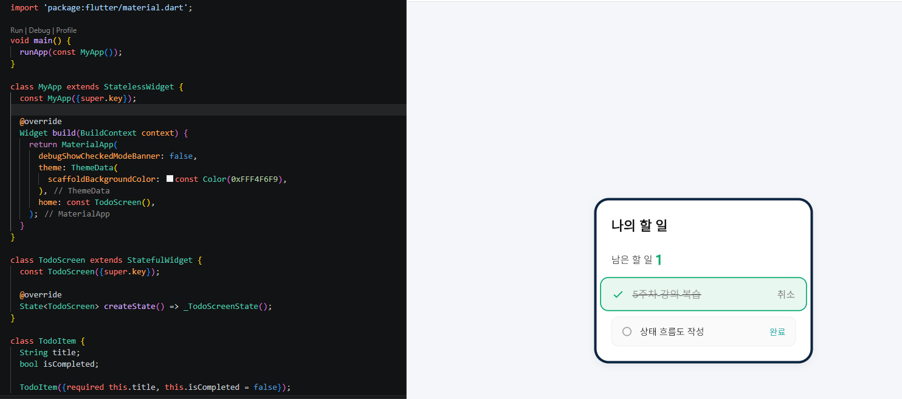

//20260915
# Flutter 과제 - 첫 번째 프로젝트 구현

## 1. 프로젝트 개요
* 프로젝트명: week2_first_app
* 목적: Flutter 개발 환경 구축 확인 및 기본 프로젝트 구조 이해

## 2. 구현 및 확인 내용
* Flutter 기본 카운터 앱(Counter App) 동작 확인
* `lib/main.dart` 파일 구조 파악 및 실행 테스트 완료
* Git 환경 설정 및 GitHub 저장소(`chlwoqls/flotter`) 연동 완료

## 3. 실행 방법
* 터미널에서 `flutter run` 명령어 입력 후 에뮬레이터 또는 기기에서 구동 확인

//20260922
# Feature Context: Study Goal Manager

## 1. 사용자 목표 (User Goal)
- 앱프로그래밍을 배우는 학생으로서 오늘의 학습 목표를 등록하고 완료 상태를 관리한다.

## 2. 사용자 스토리 (User Story)
- 앱프로그래밍을 배우는 학생으로서 나는 오늘의 학습 목표를 등록하고 완료 표시하고 싶다. 그래서 남은 학습 항목을 바로 확인할 수 있다.

## 3. 수용 조건 (Acceptance Criteria)

### AC1: 정상 입력 (Valid Input)
- **Given**: 목표 입력란에 올바른 텍스트가 입력되어 있을 때
- **When**: 사용자가 추가 버튼을 누르면
- **Then**: 목록에 새로운 학습 목표가 추가된다.

### AC2: 공백 입력 (Empty Input)
- **Given**: 목표 입력란이 비어 있거나 공백만 있을 때[cite: 3]
- **When**: 사용자가 추가 버튼을 누르면[cite: 3]
- **Then**: 목록은 추가되지 않고 "목표를 입력하세요" 오류 문구가 표시된다[cite: 3].

### AC3: 완료 상태 전환 (Complete Toggle)
- **Given**: 등록된 학습 목표 항목이 화면에 있을 때[cite: 3]
- **When**: 사용자가 해당 목표의 체크박스(완료 버튼)를 누르면[cite: 3]
- **Then**: 해당 목표의 상태가 완료(취소선 또는 완료 표시)로 전환된다[cite: 3].

# 📱 Week 04 - Widget Lab

Flutter 위젯을 조합하여 모바일 화면을 구현한 프로젝트입니다.

## 📌 과제 정보

* **과제명:** 4주차 과제 - 위젯을 조합한 모바일 화면
* **저장소:** `week04_widget_lab`
* **제출 기한:** 5주차 강의 시작 전

---

## 🎯 과제 목표

하나의 모바일 화면에 여러 위젯을 적절하게 조합하여

* 화면을 구성하고
* 콘텐츠를 배치하며
* 사용자의 동작에 따라 화면의 결과가 변경되도록 구현한다.

단순히 많은 위젯을 사용하는 것이 아니라 **각 기능에 적합한 위젯을 선택하고 선택 이유를 설명하는 것**을 목표로 한다.

---

## 🖥️ 구현 화면

### 화면 구성


### 사용한 주요 위젯

* `Scaffold`
* `AppBar`
* `Text`
* `Icon` / `Image`
* `Column`
* `Row`
* `ListView`
* `ElevatedButton` 등

---

## 🧩 위젯 선택표

| 만들 기능    | 위젯 범주 | 선택한 위젯           | 선택 이유                                |
| -------- | ----- | ---------------- | ------------------------------------ |
| 전체 화면 구성 | 화면 구조 | `Scaffold`       | 모바일 화면의 기본 구조를 구성하기 위해 사용            |
| 상단 제목 표시 | 화면 구조 | `AppBar`         | 화면 상단에 제목과 관련 요소를 배치하기 위해 사용         |
| 텍스트 표시   | 보여 주기 | `Text`           | 화면에 문자열을 표시하기 위해 사용                  |
| 아이콘 표시   | 보여 주기 | `Icon`           | 기능을 직관적으로 표현하기 위해 사용                 |
| 세로 방향 배치 | 배치    | `Column`         | 여러 위젯을 세로로 배치하기 위해 사용                |
| 가로 방향 배치 | 배치    | `Row`            | 여러 위젯을 가로로 배치하기 위해 사용                |
| 목록 표시    | 배치    | `ListView`       | 여러 콘텐츠를 스크롤 가능한 목록으로 표시하기 위해 사용      |
| 사용자 동작   | 동작    | `ElevatedButton` | 버튼을 눌렀을 때 화면의 결과를 확인할 수 있도록 하기 위해 사용 |

---

## 📚 결정 근거표

| 위젯               | 공식 문서 위치      | 직접 확인한 내용                      | 현재 화면에 적용한 이유               |
| ---------------- | ------------- | ------------------------------ | --------------------------- |
| `Scaffold`       | Flutter 공식 문서 | 화면의 기본적인 Material 구조를 구성할 수 있음 | 화면의 전체적인 구조를 만들기 위해 사용      |
| `AppBar`         | Flutter 공식 문서 | 상단 앱 바를 구성할 수 있음               | 화면 제목을 표시하기 위해 사용           |
| `Text`           | Flutter 공식 문서 | 텍스트를 화면에 표시할 수 있음              | 화면에 필요한 문자열을 표시하기 위해 사용     |
| `Icon`           | Flutter 공식 문서 | 아이콘을 표시할 수 있음                  | 기능을 시각적으로 표현하기 위해 사용        |
| `Column`         | Flutter 공식 문서 | 자식 위젯을 세로 방향으로 배치할 수 있음        | 화면의 콘텐츠를 위에서 아래로 배치하기 위해 사용 |
| `Row`            | Flutter 공식 문서 | 자식 위젯을 가로 방향으로 배치할 수 있음        | 버튼이나 콘텐츠를 가로로 배치하기 위해 사용    |
| `ListView`       | Flutter 공식 문서 | 여러 위젯을 스크롤 가능한 목록으로 표시할 수 있음   | 여러 항목을 목록 형태로 표시하기 위해 사용    |
| `ElevatedButton` | Flutter 공식 문서 | 사용자의 버튼 입력을 처리할 수 있음           | 버튼 클릭에 따른 화면 변화를 구현하기 위해 사용 |

---

## 🔘 AC1 ~ AC3 실행 결과

### AC1. 화면 구성

`Scaffold`와 `AppBar`를 사용하여 모바일 화면의 기본 구조를 구성하였다.

**확인 결과**

* [x] `Scaffold` 사용
* [x] `AppBar` 사용
* [x] 화면 제목 표시

---

### AC2. 위젯 배치

`Text`, `Icon` 또는 `Image`를 사용하고 `Row`, `Column`, `ListView` 중 두 가지 이상을 사용하여 화면을 구성하였다.

**확인 결과**

* [x] `Text` 사용
* [x] `Icon` 또는 `Image` 사용
* [x] `Row` 사용
* [x] `Column` 사용
* [x] `ListView` 사용

---

### AC3. 사용자 동작

버튼을 눌렀을 때 화면에서 결과를 확인할 수 있도록 구현하였다.

**동작 과정**

1. 사용자가 버튼을 누른다.
2. 버튼의 이벤트가 실행된다.
3. 화면의 내용 또는 상태가 변경된다.
4. 사용자는 실행 결과를 화면에서 확인할 수 있다.


---

## 🔍 제출 전 검증

* [x] `Scaffold`와 `AppBar`로 화면의 큰 틀을 구성
* [x] `Text`, `Icon` 또는 `Image` 가운데 두 가지 이상 사용
* [x] `Row`, `Column`, `ListView` 가운데 두 가지 이상 사용
* [x] 버튼을 눌렀을 때 화면에서 결과 확인 가능
* [x] 위젯 선택표의 각 항목이 실제 코드와 연결됨
* [x] 공식 문서와 직접 확인한 내용을 구분
* [ ] `flutter analyze` 경고 및 오류 없음
* [x] 비밀번호, 토큰, 개인 식별 정보가 포함되지 않음

---

## 🧪 Flutter Analyze

프로젝트의 오류 및 경고 여부를 확인하기 위해 다음 명령어를 실행하였다.

```bash
flutter analyze
```

### 결과

```text
여기에 flutter analyze 실행 결과를 작성하세요.
```

예시:

```text
No issues found!
```

---

## 📌 Git Commit

최종 구현 내용을 GitHub에 커밋하였다.

```text
Commit ID: 여기에 실제 Commit ID 입력
```

---

## 💡 마무리

이번 과제를 통해 Flutter에서 제공하는 여러 위젯의 역할을 확인하고, 화면의 목적에 맞는 위젯을 선택하여 조합하는 방법을 학습하였다.

특히 위젯을 많이 사용하는 것보다 **각 기능에 적합한 위젯을 선택하고, 실제 화면에서 어떻게 사용되는지 설명하는 것**에 중점을 두었다.



